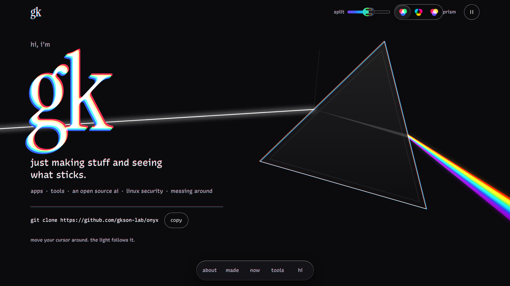

## how did we get here? 👋

i'm **gk**, and this is **gk-labs**.

🔗 **[gkson-lab.github.io/gkson-lab](https://gkson-lab.github.io/gkson-lab/)** · gk-labs, go poke the prism

- helping with Oreon and Oreon security over there ➡️
- making useful or useless apps and tools
- developing onyx, my own opensource AI
- messing around

### What I use

## Stats & Such

## big card

