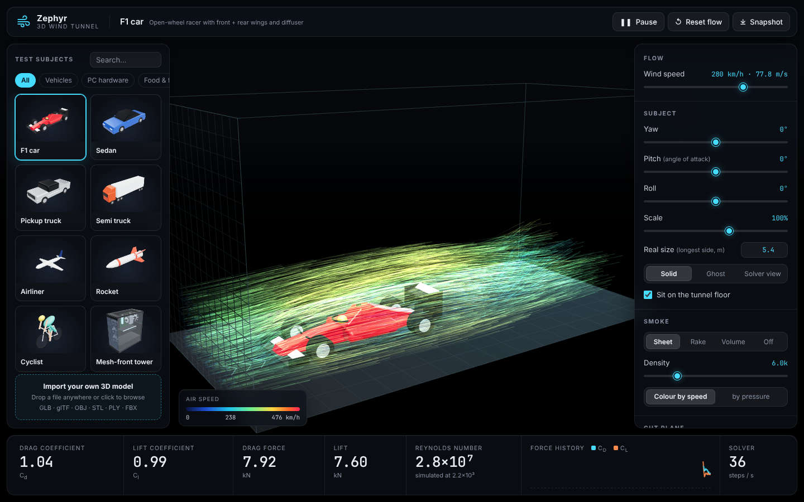

# Zephyr — 3D wind tunnel

A real-time, in-browser 3D wind tunnel. Drop an object into the test section and watch the air go around (or through) it: smoke streaks, cut planes, pressure maps and live drag/lift numbers.



## Run it

```bash
npm install
npm run dev      # http://localhost:5173
npm run build    # static site in dist/ (deploy anywhere)
npm test         # solver sanity checks
```

No backend. Everything runs client-side.

## What it does

- **Real 3D fluid solver** — a D3Q19 lattice-Boltzmann method with a Smagorinsky LES turbulence model, running in a Web Worker so the UI stays smooth. Four grid sizes from 64×32×32 (Draft) to 160×80×80 (Ultra).
- **26 presets** — F1 car, sedan, pickup, semi truck, airliner, rocket, cyclist; four PC builds and a graphics card with working fans; sandwich, burger, donut, coffee mug, rubber duck, spherical cow; sphere, golf ball, cube, cylinder, airfoil, flat plate, teardrop, city block.
- **Bring your own model** — drag in a GLB, glTF (with its .bin/textures), OBJ, STL, PLY or FBX. It is voxelised on the spot; open or messy meshes are fine.
- **PC airflow** — case fans are actuator discs that actually push air. Set wind to zero to see pure fan-driven flow, compare a mesh front against a sealed glass front, or add a cross-breeze.
- **Visualisation** — smoke as a sheet, a rake of streaklines or a volume cloud, coloured by speed or pressure; a movable cut plane showing speed, pressure coefficient or vorticity; and a *Solver view* that shows the voxel body the solver sees, painted with surface pressure.
- **Telemetry** — drag and lift coefficients, forces in newtons at the chosen wind speed and real-world size, Reynolds number, and a force history trace.
- **Controls** — yaw, pitch (angle of attack), roll, scale, floor contact, wind speed, fan power. Geometry changes re-voxelise live without restarting the flow.

Keys: `Space` pause, `R` restart the flow. `?preset=<id>` in the URL opens a preset directly.

## How it works

| Piece | File |
| --- | --- |
| LBM kernel (code-generated, unrolled stream+collide loop) | `src/sim/kernel.js` |
| Worker loop, field streaming | `src/sim/worker.js` |
| Mesh → voxels (3-axis ray parity + surface capture) | `src/sim/voxelize.js` |
| Smoke streaks, cut plane, voxel pressure view | `src/viz/` |
| Procedural presets | `src/presets/` |
| Model import | `src/loaders.js` |
| App, scene, UI | `src/main.js` |

Boundaries: velocity inlet, zero-gradient outlet, free-slip floor/walls (equivalent to a moving ground), halfway bounce-back on solids. Forces come from momentum exchange on the bounce-back links.

## Accuracy — read this before quoting numbers

This is an interactive visual tool, not certified CFD.

- The grid is coarse (an object is typically 20–50 cells long), so the simulated Reynolds number is capped far below the real one; the LES model stands in for the unresolved turbulence. The HUD shows both values.
- Bluff bodies (cube, plate, trucks, sandwich) give reasonable drag coefficients. Streamlined bodies (teardrop, airfoil) read too high because stair-stepped surfaces and unresolved boundary layers add drag.
- Gaps thinner than about two cells close up. Ground effect under a low car is not resolved at Draft/Standard, so the F1 car shows lift where a real one makes downforce. Use Fine or Ultra and a larger scale for anything that depends on small gaps.
- Forces in newtons are the measured coefficient scaled to your wind speed and the "Real size" field.
- Fan power is relative, not calibrated to CFM.
